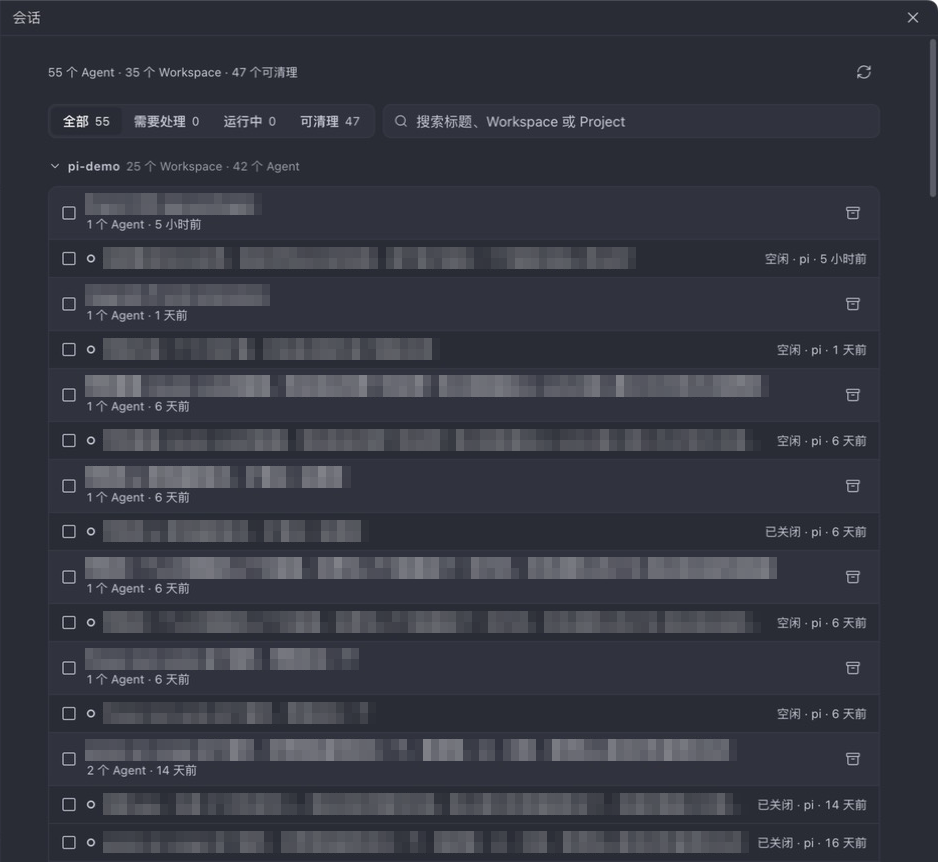

# 清理（paseo-workspace-cleaner）

Paseo 插件，侧栏和页面里叫「清理」。在线清理已归档的 Workspace 和 Agent：永久删除 Agent 与时间线，把对应的 Pi session 移到废纸篓；可选在 Workspace 归档满宽限期后自动清理。所有操作都走 Paseo 官方命令，不停 daemon，不改写 Paseo 的存储文件。



截图摄于 2026-09，是改版前的页面，会话标题做了打码。

## 清理页

- 默认只看「可清理」的 Agent，即已归档或已关闭的；一个都没有时自动切到「全部」。顶部可以按标题、Workspace 或 Project 搜索。
- 每个 Project 是一个可折叠的列表，Workspace 是列表里的分组行（名称、Agent 数、最近活动、worktree 名），Agent 是单行：状态点、标题、provider、状态、相对时间。状态点实心表示还活着（运行中为绿色），空心表示已结束。
- 点 Agent 行或它的复选框即可选中；Workspace 行的复选框一次选中或取消它下面当前可见的全部 Agent，部分选中时显示半选。选中后底部出现「删除 N 个」，确认窗口列出将删除的 Agent，选中里还有没结束的会单独提醒。
- 活跃 Workspace 行右侧的归档图标是「归档并清理」：先归档，再删除其下全部 Agent，同样要确认。

## 能做什么

- 多选批量删除 Agent，可选同时移除对应 Pi session
- 清理活跃 Workspace：先归档，再删除其下全部 Agent
- 自动清理：Workspace 归档满宽限期后，自动删除其下的 Agent，默认关闭
- 同一 Pi session 仍被其他 Agent 引用时自动保留
- Pi session 优先进系统废纸篓，废纸篓命令不可用时改名隔离，不直接永久删除

其他入口都是浮层，不开新标签页：Workspace header 的垃圾桶按钮、Command Center 两项、composer 里的 `/clean`。

header 浮层从上到下是：Workspace 名与目录，「删除范围」二选一（全部 Agent / 仅已关闭或已归档，各带数量），将受影响的 Agent 列表，Pi 会话开关，最后才是按钮。选「仅已关闭或已归档」时，空闲和运行中的行变淡并标「保留」。只有一个执行按钮，文字直接写「删除 N 个 Agent」，数量跟着范围变；范围里有运行中的 Agent 时会提示删除前先中断。范围里没有 Pi Agent 时不显示 Pi 会话开关，也不提交删除 Pi 会话。

所有清理在插件里按到达顺序排队，一次只跑一个。连续删几个 Workspace 时，后一个会等前一个跑完再开始，不会报「已有清理任务」。排队最多等 40 秒（客户端插件 RPC 的超时是 60 秒），等不到就放弃这次请求并提示稍后重试，这次什么都不删，保证提示和实际结果一致。批量删除时逐个调用官方删除命令，最后只读一次目录核对，删除后仍在的 Agent 单独报出。

header 按钮按 workspace 逐个注册，靠插件自己持有的 `workspaces.list({ subscribe: {} })` 观察得知 workspace 增删。`workspaces.subscribe()` 只是本地监听器，没有这个观察时 daemon 不推送更新，插件加载后新建的 workspace 就没有按钮。观察在重连后会再推一次快照，断线期间的增删也会补上。

已归档且下面没有 Agent 的 Workspace 不在清理页列出，因为 Paseo 自己也不再显示它们，见下文。

## 自动清理

在 Settings → Plugins → 清理设置里打开，可选宽限期 1、3、7、14、30 天，默认 7 天。

- 到期条件：Workspace 的归档时间满宽限期。其下 Agent 必须本身已归档、已关闭，且没有进行中的回合或待处理的授权，否则跳过。
- 宽限期内仍可在 Paseo 里 Restore。删除前会重读注册表，期间被 Restore 的 Workspace 不会被动到。
- 是否同时移除 Pi session，跟随「默认同时移除 Pi session」。
- 在 daemon 上运行，每小时最多一轮。插件服务端只在生命周期事件和 RPC 调用里拿得到 Paseo 会话，所以插件刚加载后要等到第一个事件（新建 Agent、回合结束、归档等）或打开清理页才开始计时。刚打开开关时会立即检查一轮。
- 和手动清理互斥。手动清理进行中时，这一轮让路，下次触发再试。
- 设置页的「状态」显示当前已满宽限期的范围（开关关着也能先看会清掉多少），以及上次自动清理的结果。结果只保存在插件进程内存里，`paseo plugin logs paseo-workspace-cleaner` 里有每一轮的记录。

## 为什么不再停机删除注册表

旧版本有一个「统一停机清理」：停掉 daemon，从 `projects/workspaces.json` 里删掉已归档 Workspace 的行，再把 daemon 拉起来。2026-10 对照 Paseo 0.11.2 的源码重新评估后移除了，原因有三个：

1. 收益接近于零。daemon 返回给 App 和 SDK 的所有 Workspace 列表都会先过滤掉已归档的。已归档 Workspace 只会通过它下面残留的 Agent（History）再冒出来，删掉这些 Agent 后就看不到了。剩下的只是注册表里一行几百字节的数据。
2. 恢复步骤从 0.9 起失效。`paseo daemon start` 改为只读 `config.json`，不再接受维护进程用的 `--listen`、`--no-web-ui`；CLI 启动的 daemon 也不再由 Desktop 托管。
3. 风险和代码量都集中在这一块：维护进程、任务锁、备份、恢复流程，以及每次 Paseo 升级都要重新验证的版本闸门。

注意一个边界：以后在同一个目录（非 worktree）新建 Workspace 时，Paseo 会复用那条已归档记录并恢复它，旧标题也会跟着回来。这是 Paseo 的设计，插件不干预。

如果确实要物理删除这些行，正确的做法是让 Paseo 提供 Workspace 删除接口。daemon 内部已经有 `workspaceRegistry.remove`，目前只用在导入失败的回滚里。

旧版停机清理留下的任务目录与备份在 `~/.paseo/workspace-cleaner/`，插件不再读写它们，确认不需要后可以手动删除。

## 兼容性

插件加载要求 Paseo >= 0.11.0（清理页用 0.11 的 `addScreen` + `addSidebarHeaderItem` 注册，manifest 用了 0.11 的 `name`），截至 2026-10 在 0.11.2 上实测正常。

截至 0.11.2，`agents.list({ includeArchived: true })` 和 `paseo agent ls -a` 仍会漏掉一部分已归档 Agent。插件读取 `~/.paseo/agents` 补齐，并逐个用 `paseo agent inspect` 确认它们确实已归档、已关闭，确认不了就拒绝继续。这是插件对 Paseo 存储唯一的直接访问，只读。

## 安装

```bash
npm install
npm run test
npm run typecheck
paseo plugin install /absolute/path/to/paseo-workspace-cleaner
paseo plugin ls
```

`paseo plugin ls` 必须为 `running`，异常时看 `paseo plugin logs paseo-workspace-cleaner`。

插件后端会调用同一台 daemon 上的 `paseo agent delete` 和 `paseo agent inspect`。`paseo` 不在 daemon 的 `PATH` 时，用 daemon 环境变量 `PASEO_CLI_PATH` 指定绝对路径，实际生效的值与来源可在设置页「状态」里确认。

## 开发

编译边界由目录决定：

```text
index.client.tsx          # App 侧入口：清理页、侧栏项、Command Center、设置页、header 按钮、/clean
index.server.ts           # daemon 子进程入口：settings、RPC handler、自动清理的触发与定时
client/                   # 只编译进 App bundle
server/cleanup.ts         # 删除 Agent、移除 Pi session、手动与自动共用的进程内互斥
server/auto-cleanup.ts    # 到期判定（纯函数）与自动清理调度
server/registry.ts        # Paseo 注册表与 Agent 存储的只读访问
shared/                   # 两侧共用：Zod 契约、settings 定义、纯值与纯函数
```

源码改动后先测试、类型检查，再 `paseo plugin reload paseo-workspace-cleaner`，无需重启 daemon。单元测试使用临时目录和模拟的 `paseo` 命令，不在真实用户数据上执行删除。
